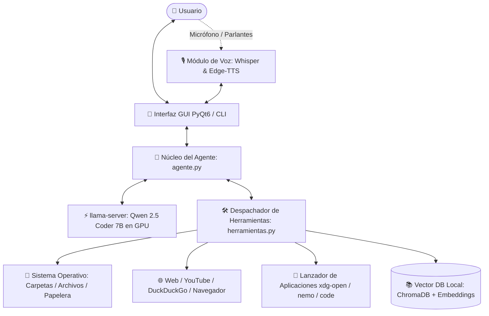

# 🤖 Mi Asistente IA de Escritorio (Local AI Desktop Companion)

[](https://www.python.org/)
[](https://linuxmint.com/)
[](https://developer.nvidia.com/cuda-zone)
[-blueviolet?style=flat)](https://github.com/ggerganov/llama.cpp)
[](https://www.riverbankcomputing.com/software/pyqt/)
[](#-desarrollado-100-por-un-agente-de-ia)
[](https://opensource.org/licenses/MIT)

> [!NOTE]
> 🤖 **Desarrollo 100% Agéntico (AI-Agent Built):** Este proyecto es una demostración real de ingeniería asistida por Inteligencia Artificial de principio a fin. Toda la arquitectura, interfaz gráfica, gestión de audio en tiempo real, integración con el sistema operativo y resolución de bugs fue ideada, escrita y depurada de forma autónoma por un agente de IA en colaboración continua (*pair-programming*) con el usuario.

Un asistente personal autónomo, inteligente y **100% local** para Linux (optimizado para Linux Mint y entornos GNOME/Cinnamon), impulsado por **Qwen 2.5 Coder 7B Instruct** con aceleración por GPU (CUDA).

Diseñado para interactuar directamente con tu sistema operativo mediante **Function Calling nativo**, entrada y salida de **voz en tiempo real**, **RAG sobre tus documentos personales** y una **interfaz gráfica compacta y moderna** invocable con un atajo global de teclado.

---

## ✨ Características Principales

- 🔒 **100% Privado y Local:** Ningún dato, prompt o documento sale de tu computadora. Corre directo sobre `llama-server` (llama.cpp) sin necesidad de abrir aplicaciones externas pesadas.
- 🛠️ **Agente con Herramientas Reales (Tool Calling):**
  - **Archivos y Carpetas:** Crea, lee, modifica, lista y busca archivos o directorios en lenguaje natural.
  - **Papelera Segura:** En lugar de eliminaciones destructivas irreversibles, utiliza `gio trash` para enviar archivos y carpetas a la Papelera de reciclaje.
  - **Navegación Web y Multimedia:** Abre YouTube (`abrir_youtube`), busca videos (`buscar_youtube`), abre cualquier sitio web en el navegador y realiza búsquedas en DuckDuckGo (`ddgs`).
  - **Lanzador de Aplicaciones:** Abre programas instalados (`code`, `firefox`, `nemo`, terminal, etc.) reconociendo nombres coloquiales y alias.
- 📚 **RAG Local (Búsqueda Semántica de Documentos):**
  - Indexa tus apuntes, notas o código fuente (`.txt`, `.md`, `.py`) en una base vectorial local con **ChromaDB** y embeddings multilingües (**Sentence Transformers**).
  - Pregúntale a tu asistente sobre información específica de tus archivos personales.
- 🎙️ **Control por Voz Bidireccional:**
  - **Dictado (STT):** Transcripción continua por micrófono usando **Faster-Whisper** (`small` con soporte CUDA/CPU).
  - **Voz en alta calidad (TTS):** Respuestas habladas con voces neuronales naturales en español rioplatense/latino mediante **Edge-TTS** (`es-AR-TomasNeural`).
- 🎨 **Doble Interfaz:**
  - **GUI Moderna (PyQt6):** Paleta oscura inspirada en *Catppuccin Macchiato*, indicadores visuales de herramientas ejecutadas en tiempo real (`📁`, `📄`, `▶️`, `🌐`, `🚀`, `⚡`), botón de dictado con pulso y toggle de voz.
  - **Modo Consola (CLI):** Chat interactivo ágil y liviano para terminales.
- ⚡ **Acceso Rápido Global:** Atajo de teclado del sistema (**`Ctrl + Alt + Espacio`**) para abrir o enfocar la ventana instantáneamente desde cualquier aplicación.

---

## 🤖 Desarrollado 100% por un Agente de IA

Este proyecto no fue creado utilizando simples autocompletados o fragmentos de código aislados; es el resultado de un proceso de **desarrollo agéntico autónomo (Agentic AI Software Engineering)** de principio a fin:

1. **Diseño y Arquitectura de Extremo a Extremo:**
   - **Backend Desacoplado:** El agente configuró el motor de inferencia local con `llama-server` (con aceleración CUDA, Flash Attention y tamaño de contexto de 8192 tokens) gestionado como servicio de usuario en `systemd`, prescindiendo de interfaces gráficas pesadas para el modelo.
   - **Frontend Reactivo en PyQt6:** Diseñó la interfaz gráfica con estética flotante compacta inspirada en *Catppuccin*, implementando hilos secundarios (`QThread`) para garantizar una interfaz fluida sin congelamientos durante la inferencia o el dictado.
   - **Pipeline de Audio en Tiempo Real:** Integró `faster-whisper` con ventana deslizante y solapamiento dinámico para transcripción continua de voz, junto con síntesis neuronal vía `edge-tts`.
   - **RAG Local Persistente:** Diseñó el sistema de chunking, embeddings multilingües y almacenamiento vectorial con `ChromaDB` para consulta semántica de notas y código.

2. **Diagnóstico y Corrección Autónoma de Fallas:**
   - Durante las pruebas, el agente diagnosticó fallas analizando logs del sistema (por ejemplo, discrepancias dinámicas en herramientas como `abrir_youtube`, tolerancia a parámetros ausentes y compatibilidad de navegadores), aplicando parches inmediatos y comprobando los resultados con tests funcionales.

3. **Meta-Desarrollo (Un Agente creando a otro Agente):**
   - El proyecto ilustra un hito de la programación moderna: **un agente de IA diseñando, programando y optimizando a otro agente de IA local** capaz de razonar, usar herramientas reales y asistir al usuario en su sistema operativo.

---

## 🏛️ Arquitectura del Sistema



---

## 📋 Requisitos Previos

- **Sistema Operativo:** Linux (probado en Linux Mint 21/22 y Ubuntu 22.04/24.04).
- **GPU (Recomendada):** NVIDIA con soporte CUDA (ej. RTX 2070 Super o similar con ≥6GB VRAM para máxima velocidad con Qwen 2.5 Coder 7B Q4_K_M). También funciona en CPU.
- **Python:** 3.10 o superior (incluyendo 3.12).
- **Herramientas de sistema:** `xdg-open`, `gio` (integrado en GNOME/Cinnamon), `wmctrl` (opcional, para alternar ventana).

---

## 🚀 Instalación y Puesta en Marcha

### 1. Clonar el repositorio y crear el entorno virtual

```bash
git clone https://github.com/tu-usuario/mi-asistente-ia.git
cd mi-asistente-ia

# Crear y activar entorno virtual
python3 -m venv venv
source venv/bin/activate

# Instalar dependencias
pip install -r requirements.txt
```

### 2. Descargar el Modelo GGUF

Podés descargar el modelo cuantizado en formato GGUF desde Hugging Face (por ejemplo, mediante LM Studio o `huggingface-cli`):

- **Modelo recomendado:** `Qwen2.5-Coder-7B-Instruct-Q4_K_M.gguf`
- Ubicación por defecto configurada en `iniciar_servidor_modelo.sh`:
  `~/.lmstudio/models/lmstudio-community/Qwen2.5-Coder-7B-Instruct-GGUF/Qwen2.5-Coder-7B-Instruct-Q4_K_M.gguf`

### 3. Configurar el Servidor Local (`llama-server`)

El servidor corre el modelo de forma ultraeficiente sin interfaces pesadas:

```bash
# Otorgar permisos de ejecución
chmod +x iniciar_servidor_modelo.sh

# Probar el inicio del servidor
./iniciar_servidor_modelo.sh
```

#### (Opcional) Configurar como servicio de usuario en systemd:
Creá el archivo `~/.config/systemd/user/asistente-modelo.service`:

```ini
[Unit]
Description=Servidor local de IA (llama-server Qwen2.5-Coder)
After=network.target

[Service]
Type=simple
ExecStart=/bin/bash /ruta/a/mi-asistente-ia/iniciar_servidor_modelo.sh
Restart=on-failure
RestartSec=3

[Install]
WantedBy=default.target
```

Luego activalo:
```bash
systemctl --user daemon-reload
systemctl --user enable --now asistente-modelo.service
```

### 4. Lanzador Global y Atajo de Teclado

Para ejecutar el asistente desde cualquier terminal o atajo de teclado:

1. Creá o enlazá el ejecutable en `~/.local/bin/asistente`:
   ```bash
   chmod +x asistente
   ln -s "$(pwd)/asistente" ~/.local/bin/asistente
   ```
2. **Atajo Global:** En la configuración de tu sistema (Configuración -> Teclado -> Atajos personalizados):
   - **Nombre:** `Mi Asistente IA`
   - **Comando:** `/home/tu_usuario/.local/bin/asistente`
   - **Atajo:** `Ctrl + Alt + Espacio`

---

## 💻 Uso

### 1. Interfaz Gráfica (Recomendada)
```bash
asistente
```
- Escribí tu solicitud o hacé clic en el botón **🎙️** para dictarle por voz.
- Activá el parlante **🔊** para que el asistente te responda con voz natural.
- Presioná `Escape` o `Ctrl + Alt + Espacio` para ocultar o volver a traer la ventana.

### 2. Modo Terminal (CLI)
```bash
asistente --cli
```
- Escribí comandos o usá `/leer` para alternar la lectura en voz alta.
- Comandos útiles: `limpiar` / `clear` para reiniciar la memoria del agente.

### 3. Gestión del Servidor del Modelo
```bash
asistente --server   # Reinicia y verifica el estado del servicio systemd
```

---

## 📚 Indexar Documentos Propios (RAG Local)

Podés dotar a tu asistente de conocimiento sobre tus notas, apuntes o proyectos de código:

```bash
# Indexar una carpeta de documentos o apuntes
python indexar_documentos.py ~/Documentos/MisNotas

# O indexar un proyecto de código
python indexar_documentos.py ~/Proyectos/mi-codigo
```

Luego podés preguntarle directamente:
> *"¿Qué decía mi apunte sobre la arquitectura de microservicios?"*  
> *"Consultá en mis documentos la receta de masa madre."*

---

## 🗣️ Ejemplos de Interacción

| Intención | Ejemplo de lo que podés decirle | Acción ejecutada |
| :--- | :--- | :--- |
| **YouTube** | *"Abrí una página de YouTube"* | Abre `https://www.youtube.com` en Chrome/navegador predeterminado. |
| **Búsqueda en YouTube** | *"Buscá en YouTube cómo calibrar una guitarra"* | Abre la búsqueda directa del video en YouTube. |
| **Navegador Web** | *"Abrí la página de GitHub"* | Abre `https://github.com` en el navegador. |
| **Crear Carpetas** | *"Iniciá una carpeta llamada Proyectos en el Escritorio"* | Crea `~/Escritorio/Proyectos` en el sistema. |
| **Crear Notas** | *"Creá un archivo notas.txt en el escritorio con la lista de compras"* | Escribe el archivo con el texto solicitado. |
| **Abrir Explorador** | *"Abrí la carpeta Descargas"* | Abre la ventana de Nemo/gestor de archivos gráfico en `~/Descargas`. |
| **Papelera Segura** | *"Eliminá la carpeta Proyectos"* | Envía la carpeta a la Papelera de reciclaje (`gio trash`). |
| **Búsqueda en Internet** | *"Buscá en internet qué temperatura hace hoy en Buenos Aires"* | Consulta DuckDuckGo y resume la respuesta en español. |
| **Abrir Programas** | *"Abrí VS Code"* o *"Abrí la terminal"* | Ejecuta la aplicación en segundo plano. |
| **RAG Personal** | *"¿Qué dice mi apunte sobre derivadas en mis notas?"* | Consulta la base de vectores ChromaDB y responde con tus datos. |

---

## 🗂️ Estructura del Código

```text
mi-asistente/
├── agente.py                  # Núcleo del agente: loop de razonamiento, OpenAI API local, tool parsing
├── herramientas.py            # Implementación y definición de herramientas (OS, web, apps, RAG)
├── interfaz_gui.py            # GUI en PyQt6 con estilo Catppuccin, gestión de hilos y animación
├── asistente_chat.py          # Interfaz CLI interactiva para terminal
├── voz.py                     # STT (Faster-Whisper con ventana deslizante) y TTS (Edge-TTS)
├── indexar_documentos.py      # Script de ingestión de documentos para RAG con ChromaDB
├── iniciar_servidor_modelo.sh # Script de arranque optimizado de llama-server (CUDA)
├── requirements.txt           # Dependencias de Python
└── README.md                  # Documentación del proyecto
```

---

## 🛡️ Seguridad y Resguardo del Sistema

El asistente cuenta con medidas preventivas integradas:
- **Protección de rutas críticas:** Bloquea explícitamente cualquier orden que intente eliminar directorios del sistema como `/`, `/root`, `/bin`, `/usr`, `/etc` o las carpetas raíz del usuario.
- **Borrado no destructivo:** Utiliza la papelera estándar de Linux (`gio trash`), permitiendo restaurar cualquier archivo o carpeta borrada por error.
- **Tolerancia a fallas:** Si el modelo genera variaciones de nombres de herramientas (por ejemplo `abrir_youtube` vs `buscar_youtube`), el despachador cuenta con resolución inteligente de nombres para evitar bloqueos.

---

## 📄 Licencia

Distribuido bajo la Licencia **MIT**. Consulta el archivo `LICENSE` para más detalles.

---

<p align="center">
  Desarrollado con ❤️ para la comunidad de código abierto y entusiastas de la Inteligencia Artificial Local.
</p>
